# Projeto - Cidades ESG Inteligentes

API REST em **Java 21 + Spring Boot** para cadastrar e consultar **indicadores ESG** (Ambiental, Social e Governança) de cidades, como consumo de energia, coleta seletiva, acesso a saneamento ou transparência nos gastos públicos.

O foco do projeto é aplicar as práticas de **DevOps** vistas na fase *"Navegando pelo mundo DevOps"*: pipeline de CI/CD com **GitHub Actions**, containerização com **Docker**, publicação da imagem no **Docker Hub**, orquestração com **Docker Compose** e deploy automatizado em dois ambientes: **staging** e **produção**.

**Integrantes:**

| Nome | RM |
|------|----|
| Caio Agnello | RM563108 |
| Giovanna Vasconcelos Egawa | RM_____ |
| Sarah Schulze Bittar Bonafé | RM563780 |

**Repositório:** https://github.com/SarahSBB-Dev/cidades-esg-inteligentes

## Estrutura do projeto

```
cidades-esg-inteligentes/
├── Dockerfile                         # imagem da aplicação (build com Maven + runtime com JRE 21)
├── docker-compose.yml                 # orquestração local: API + MySQL
├── .env.example                       # modelo das variáveis de ambiente do compose
├── pom.xml                            # dependências e build (Maven)
├── scripts/
│   ├── verificar-ambiente.sh          # verifica se o ambiente está no ar e no profile correto
│   └── testar-api.sh                  # testa cadastro, listagem, filtro e validação da API
├── src/
│   ├── main/java/br/com/fiap/esg/
│   │   ├── controller/                # IndicadorEsgController e StatusController
│   │   ├── service/                   # regras de negócio
│   │   ├── repository/                # Spring Data JPA
│   │   ├── model/                     # entidade IndicadorEsg e enum CategoriaEsg
│   │   ├── dto/                       # records de cadastro e exibição
│   │   ├── exception/                 # exceção de indicador não encontrado
│   │   └── advice/                    # tratamento global de erros
│   ├── main/resources/
│   │   ├── application.properties     # configurações comuns
│   │   ├── application-dev.properties # profile dev (ambiente local)
│   │   ├── application-stg.properties # profile stg (staging)
│   │   └── application-prd.properties # profile prd (produção)
│   └── test/java/br/com/fiap/esg/     # testes automatizados (JUnit 5)
├── prints/                            # evidências de funcionamento
├── docs/                              # documentação técnica (PDF)
└── .github/workflows/
    └── ci-cd.yml                      # pipeline de CI/CD (GitHub Actions)
```

## Endpoints da API

| Método | Rota | Descrição |
|--------|------|-----------|
| GET | `/api/status` | Mostra se a aplicação está no ar e em qual ambiente (`dev`, `stg` ou `prd`) |
| GET | `/api/indicadores` | Lista os indicadores (filtro opcional `?categoria=AMBIENTAL`, `SOCIAL` ou `GOVERNANCA`) |
| GET | `/api/indicadores/{id}` | Busca um indicador pelo id |
| POST | `/api/indicadores` | Cadastra um indicador |
| PUT | `/api/indicadores/{id}` | Atualiza um indicador |
| DELETE | `/api/indicadores/{id}` | Exclui um indicador |

Exemplo de corpo para `POST` e `PUT`:

```json
{
  "cidade": "São Paulo",
  "categoria": "AMBIENTAL",
  "nome": "Energia renovável na iluminação pública",
  "valor": 78.5,
  "unidade": "%",
  "dataMedicao": "2026-10-01"
}
```

## Como executar localmente com Docker

Pré-requisito: **Docker Desktop** instalado e em execução.

1. Clone o repositório e entre na pasta do projeto:
   ```bash
   git clone https://github.com/SarahSBB-Dev/cidades-esg-inteligentes.git
   cd cidades-esg-inteligentes
   ```
2. Crie o arquivo `.env` a partir do modelo (no Windows use `copy .env.example .env`):
   ```bash
   cp .env.example .env
   ```
3. Construa a imagem e suba a API e o banco MySQL:
   ```bash
   docker compose up --build
   ```
4. Teste a aplicação (navegador, Insomnia ou curl):
   - Status: http://localhost:8080/api/status → `"ambiente":"dev"`
   - Indicadores: http://localhost:8080/api/indicadores
5. Para parar os containers: `docker compose down` (use `docker compose down -v` para apagar também o volume do banco).

Para rodar só os testes automatizados (precisa do JDK 21 e do Maven): `mvn test`.

## Pipeline CI/CD

**Ferramenta:** GitHub Actions, arquivo `.github/workflows/ci-cd.yml`.

**Fluxo de branches:** o desenvolvimento acontece em branches `feature/*`, que são integradas na `develop` por pull request. A `develop` é publicada em **staging**. Depois de validada, a `develop` é mesclada na `main`, que é publicada em **produção**.

| Etapa (job) | Quando roda | O que faz |
|-------------|-------------|-----------|
| 1. `build-test` - Build e testes | push e pull request em `develop` e `main` | Configura o Java 21, executa os **testes automatizados** (`mvn test`) e gera o `app.jar` (`mvn package`) |
| 2. `docker` - Build e push da imagem | push em `develop` e `main` | Constrói a imagem a partir do `Dockerfile` e envia ao **Docker Hub** com as tags `<sha do commit>` e `latest` |
| 3. `deploy-staging` - Deploy em staging | após a etapa 2 | Implanta a imagem publicada no environment **staging** (API + MySQL com Docker Compose, `PROFILE=stg`), verifica o ambiente e testa a API |
| 4. `deploy-producao` - Deploy em produção | após a etapa 3, **somente na `main`** | Implanta **a mesma imagem** no environment **production** (`PROFILE=prd`), verifica o ambiente e testa a API |

**Funcionamento:**

- Cada etapa depende da anterior (`needs`). Se os testes falharem, nenhuma imagem é gerada. Se o deploy em staging falhar, a produção não é atualizada.
- Os jobs de deploy usam os **environments** `staging` e `production` do GitHub, que registram cada implantação na página *Deployments* do repositório.
- Em cada deploy, o pipeline:
  1. cria o arquivo `.env` do ambiente (profile, nome do banco, senha gerada na hora e imagem a implantar);
  2. faz login no Docker Hub e baixa a imagem publicada na etapa 2 (`docker compose pull`);
  3. sobe a API e o MySQL com o `docker-compose.yml` do projeto (`docker compose up -d`), com volume, rede e variáveis de ambiente;
  4. roda `scripts/verificar-ambiente.sh`, que espera `/api/status` responder com o profile do ambiente (`stg` ou `prd`);
  5. roda `scripts/testar-api.sh`, que cadastra um indicador de cada pilar ESG, confere que dados inválidos são recusados (HTTP 400) e lista os indicadores;
  6. mostra os containers (`docker compose ps`) e os logs da aplicação, e encerra o ambiente.
- Staging e produção recebem **exatamente a mesma imagem** (tag com o SHA do commit). Entre os ambientes mudam só as variáveis de ambiente.

**Secrets configurados no repositório** (Settings → Secrets and variables → Actions):

| Secret | Uso |
|--------|-----|
| `DOCKERHUB_USERNAME` | usuário do Docker Hub |
| `DOCKERHUB_TOKEN` | token de acesso do Docker Hub (Read & Write) |

**Ambientes:**

| Ambiente | Environment no GitHub | Profile | Banco |
|----------|-----------------------|---------|-------|
| Local | - | `dev` | MySQL `esg` |
| Staging | `staging` | `stg` | MySQL `esg_staging` |
| Produção | `production` | `prd` | MySQL `esg_producao` |

## Containerização

**Dockerfile:**

```dockerfile
# Etapa de build: usa uma imagem com o Maven e Java 21 para compilar o projeto
FROM maven:3.9.8-eclipse-temurin-21 AS build
RUN mkdir /opt/app
COPY . /opt/app
WORKDIR /opt/app
RUN mvn clean package -DskipTests

# Etapa de runtime: usa uma imagem leve com apenas o JRE para rodar o app
FROM eclipse-temurin:21-jre-alpine
RUN mkdir /opt/app
COPY --from=build /opt/app/target/app.jar /opt/app/app.jar
WORKDIR /opt/app
ENV PROFILE=prd
EXPOSE 8080
ENTRYPOINT ["sh", "-c", "java -Dspring.profiles.active=$PROFILE -jar app.jar"]
```

**Estratégias adotadas:**

- **Build em duas etapas (multi-stage):** a primeira etapa usa a imagem do Maven para compilar e gerar o `app.jar`. A imagem final usa só o JRE 21 em Alpine, então fica menor e não leva o código-fonte nem o Maven.
- **Profile por variável de ambiente:** a variável `PROFILE` define o profile do Spring (`dev`, `stg` ou `prd`). A mesma imagem roda em qualquer ambiente, mudando apenas a configuração.
- **`.dockerignore`:** evita copiar para a imagem arquivos desnecessários, como `target/`, `.git/`, `.env`, prints e documentação.
- **Testes fora da imagem:** os testes rodam no job de CI. Por isso o build da imagem usa `-DskipTests`.
- **Imagem versionada:** cada imagem publicada recebe a tag com o SHA do commit, então dá para saber exatamente qual versão está em cada ambiente.

**Orquestração com Docker Compose (`docker-compose.yml`):**

- **Serviços:** `api` (aplicação Spring Boot, construída pelo Dockerfile) e `db` (MySQL 8.0).
- **Volume:** `db_data`, que guarda os dados do MySQL mesmo se o container for recriado.
- **Rede:** `esg-network` (bridge). A API acessa o banco pelo nome do serviço: `jdbc:mysql://db:3306/...`.
- **Variáveis de ambiente:** vêm do arquivo `.env` (modelo em `.env.example`): `PROFILE`, `DB_NAME`, `DB_ROOT_PASSWORD` e `APP_IMAGE`. A API recebe `DATABASE_URL`, `DATABASE_USER` e `DATABASE_PWD`.
- **Healthcheck:** o MySQL é verificado com `mysqladmin ping`. A API só sobe depois que o banco está saudável (`depends_on` com `condition: service_healthy`).

**Mesma orquestração em todos os ambientes:** o `docker-compose.yml` é usado localmente e nos deploys de staging e produção. Localmente, a imagem da API é construída pelo Dockerfile (`build: .`). Nos deploys, a variável `APP_IMAGE` aponta para a imagem publicada no Docker Hub.

## Prints do funcionamento

As evidências ficam na pasta [`prints/`](prints/) e também estão na documentação em PDF (pasta [`docs/`](docs/)).

Execuções do pipeline: https://github.com/SarahSBB-Dev/cidades-esg-inteligentes/actions

### Pipeline

**Execução completa do pipeline na branch `main`: build e testes, imagem Docker, deploy em staging e deploy em produção**

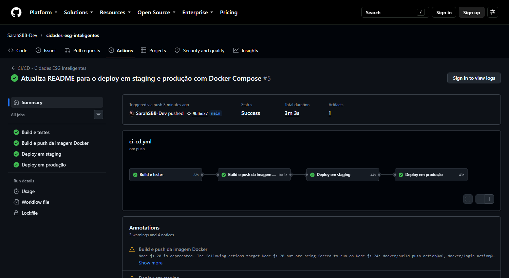

**Push na branch `develop`: o pipeline publica só em staging (produção é pulada)**

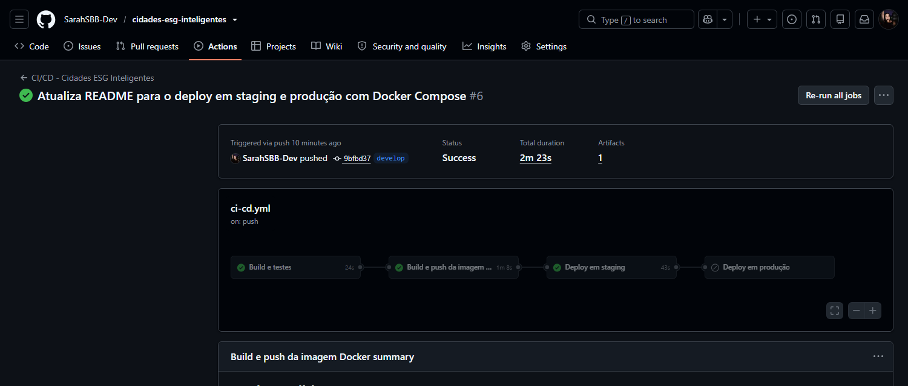

**Job "Build e testes"**

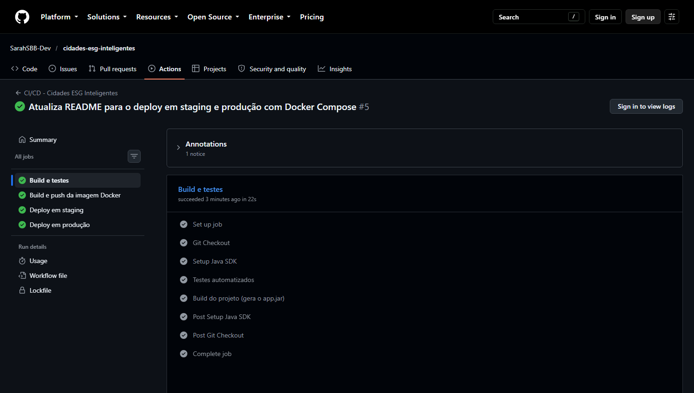

**Testes automatizados (`mvn test`): Tests run: 8, Failures: 0, Errors: 0 - BUILD SUCCESS**

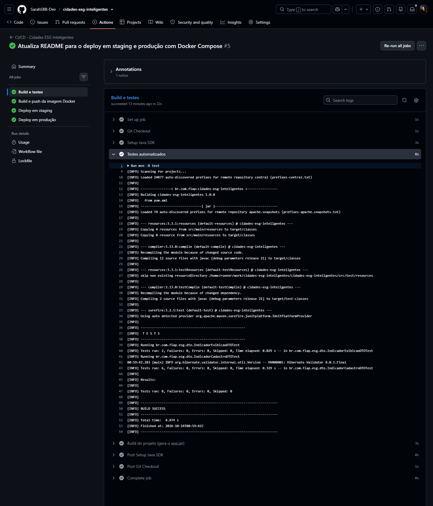

**Job "Build e push da imagem Docker"**

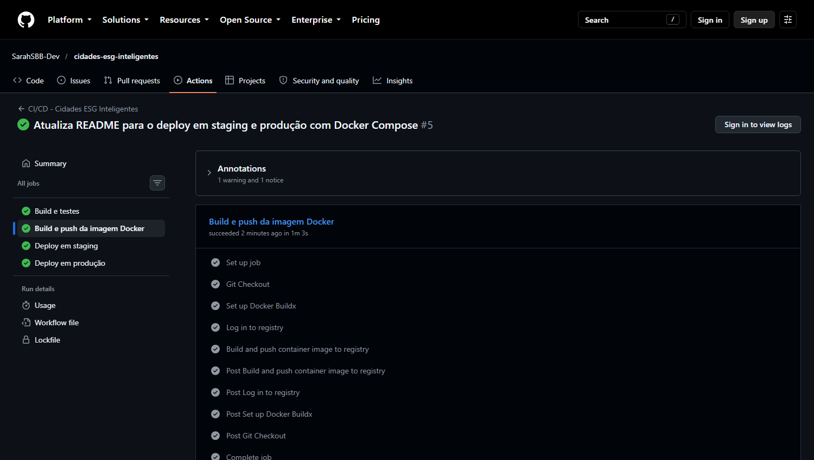

**Imagem publicada no Docker Hub com a tag do commit e a tag `latest`**

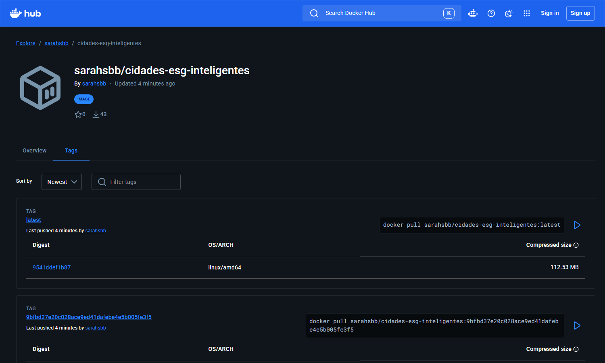

**Job "Deploy em staging"**

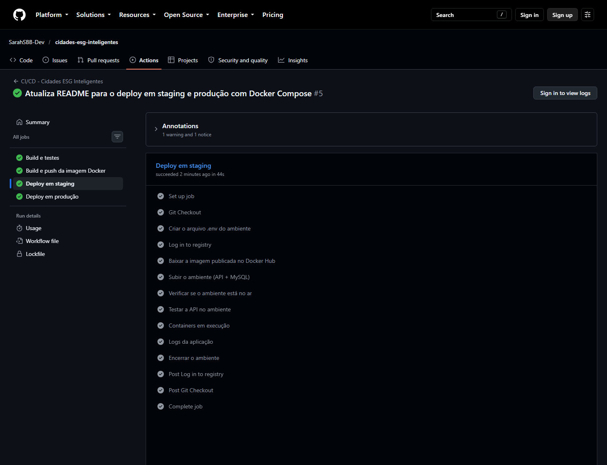

**Job "Deploy em produção"**

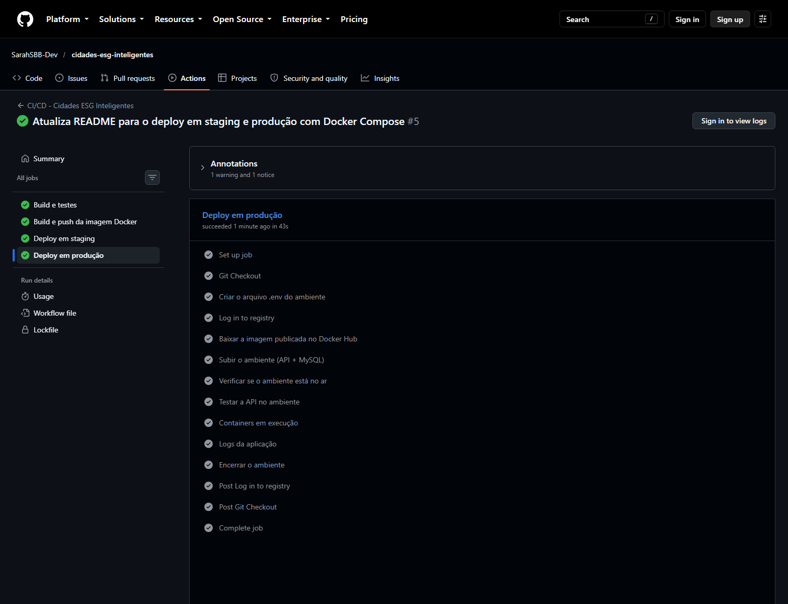

**Environments `staging` e `production` com o histórico de deploys**

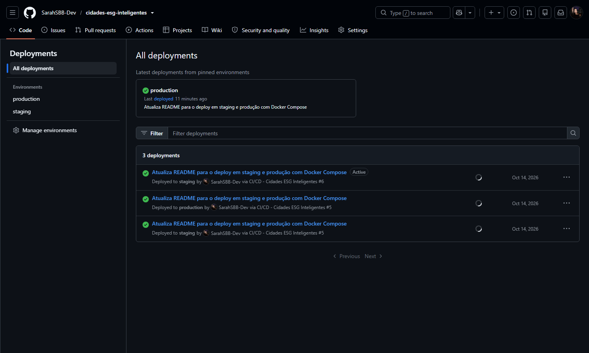

### Ambientes staging e produção funcionando

**Staging: `/api/status` responde com `"ambiente":"stg"`**

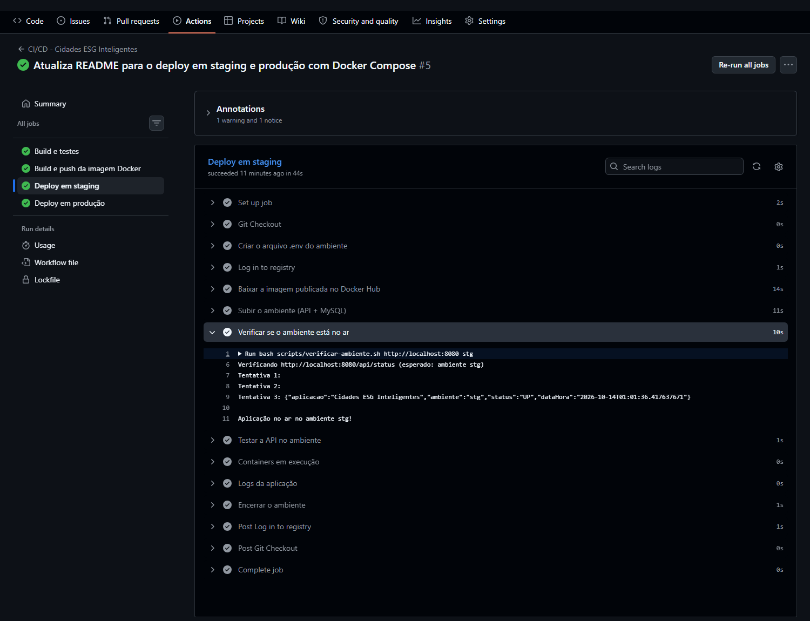

**Staging: cadastros (HTTP 201), validação de dados inválidos (HTTP 400) e listagem dos indicadores**

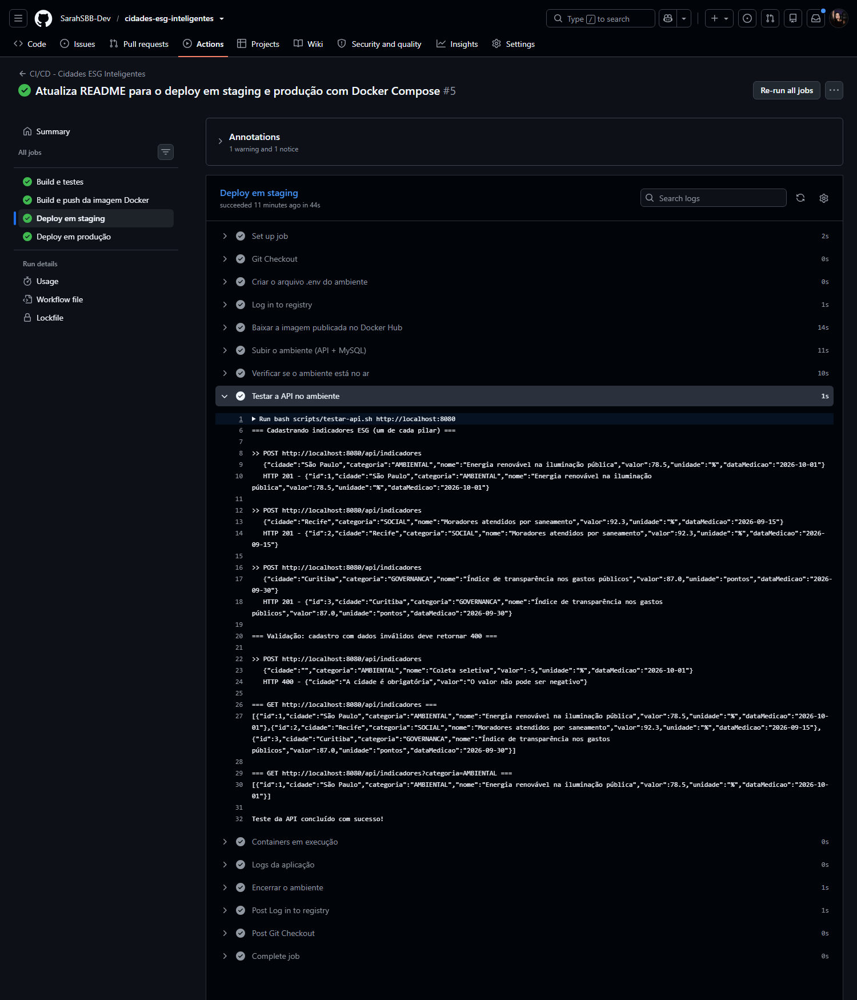

**Produção: `/api/status` responde com `"ambiente":"prd"`**


**Produção: cadastros (HTTP 201), validação de dados inválidos (HTTP 400) e listagem dos indicadores**

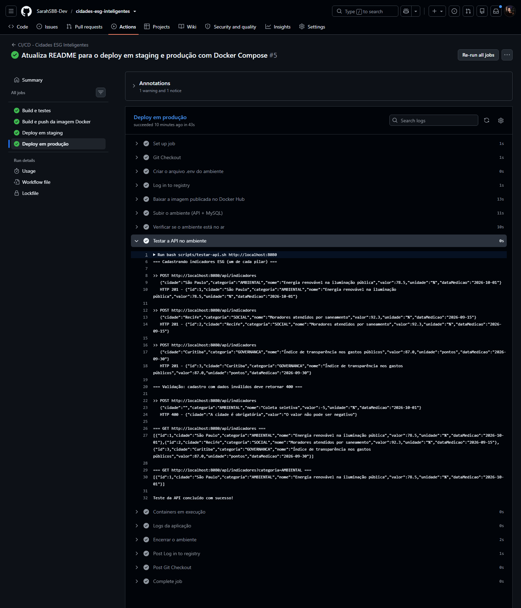

**Containers da API e do MySQL (healthy) em execução no ambiente (`docker compose ps`)**

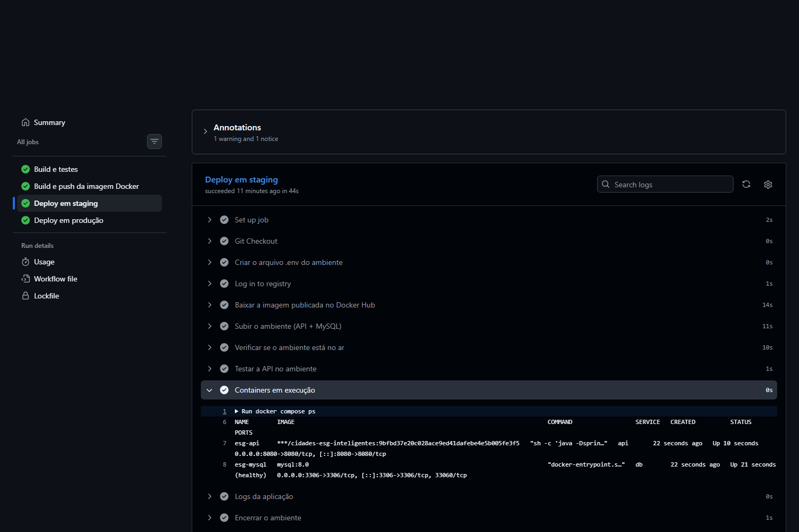

## Tecnologias utilizadas

- **Linguagem e framework:** Java 21, Spring Boot 3.3 (Spring Web, Spring Data JPA, Bean Validation)
- **Banco de dados:** MySQL 8.0 (via Docker Compose em todos os ambientes)
- **Testes:** JUnit 5 (`spring-boot-starter-test`)
- **Build:** Maven
- **Containerização e orquestração:** Docker e Docker Compose
- **Registro de imagens:** Docker Hub
- **CI/CD:** GitHub Actions (com environments `staging` e `production`)
- **Scripts:** Bash + curl (verificação do ambiente e teste da API)
- **Versionamento:** Git e GitHub

## Checklist de entrega

| Item | OK |
|------|----|
| Projeto compactado em .ZIP com estrutura organizada | ☑ |
| Dockerfile funcional | ☑ |
| docker-compose.yml ou arquivos Kubernetes | ☑ |
| Pipeline com etapas de build, teste e deploy | ☑ |
| README.md com instruções e prints | ☑ |
| Documentação técnica com evidências (PDF ou PPT) | ☑ |
| Deploy realizado nos ambientes staging e produção | ☑ |
